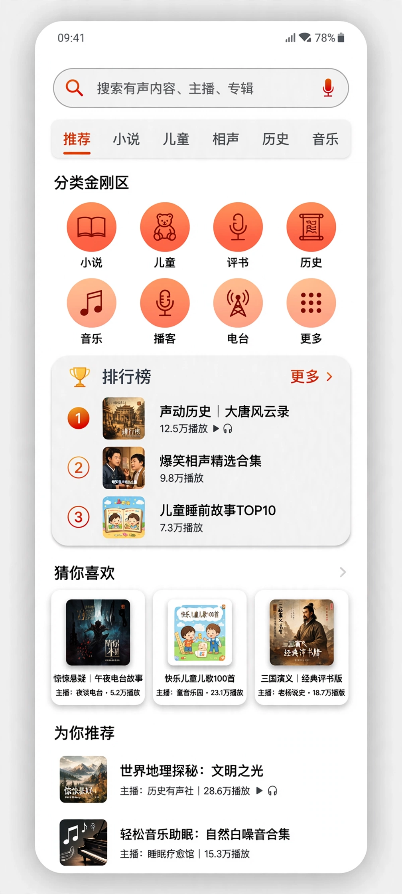
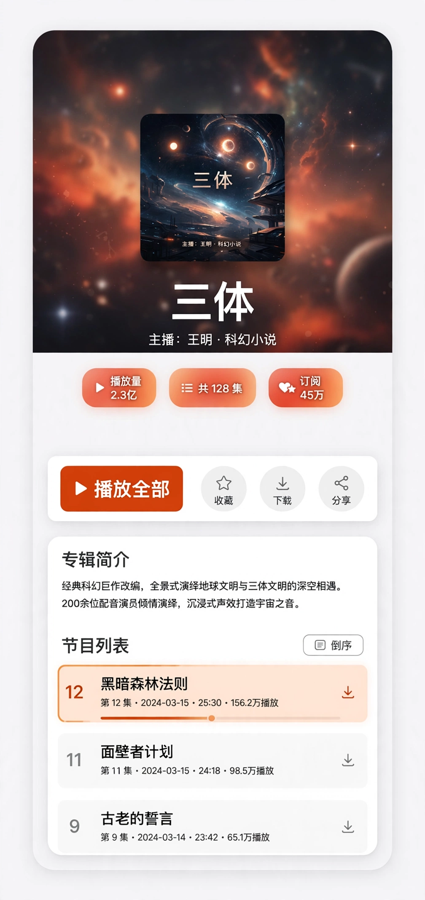
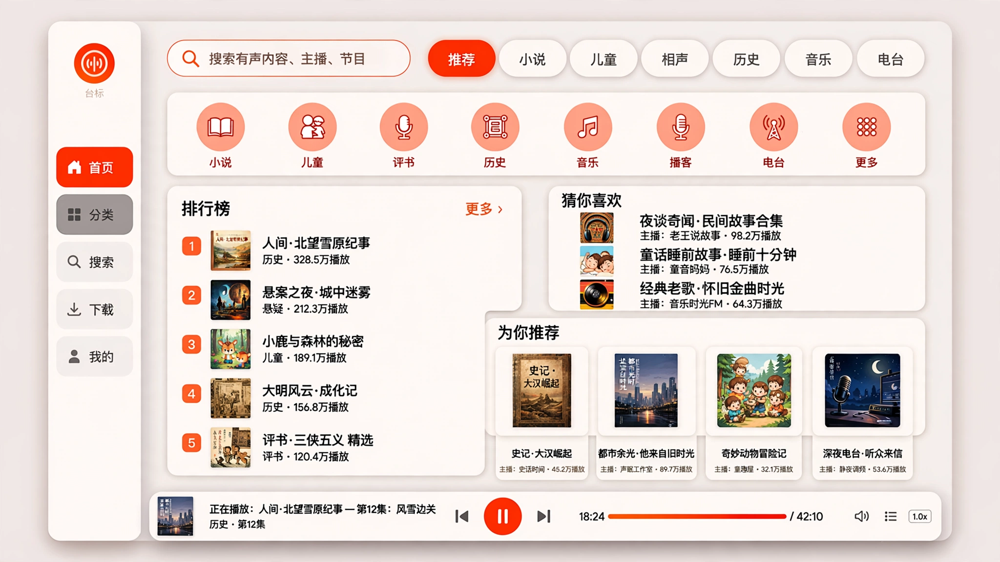
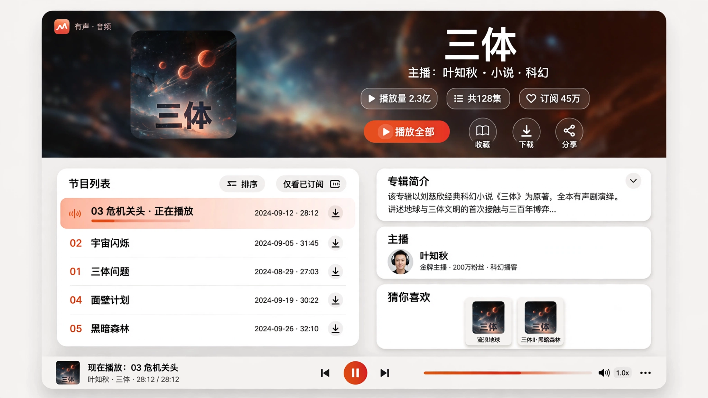

<p align="center">
  
</p>

# xmlyfm（喜马拉雅第三方客户端）

非官方第三方 Flutter 客户端，**访客态浏览 + 播放**：无需登录、无自建后端，直连喜马拉雅官方接口（`mobile.ximalaya.com` / `search.ximalaya.com`，接口整理自官方 App 逆向文档）。

- UI：原生 Material 3，动态取色 / 自定义种子色 / 纯黑模式
- 布局自适应：手机底部导航；宽屏（≥600）左侧 NavigationRail，专辑页 / 播放页双栏
- 平台：Android / iOS / macOS / Windows

> 免责声明：本项目仅供学习研究使用，与喜马拉雅官方无关，请遵守国家法律法规。

## 界面预览

以下为设计样板图（效果示意，实际界面以发行版为准）：

| 移动端 · 首页 | 移动端 · 专辑详情 |
| --- | --- |
|  |  |
| 分类金刚区 + 排行榜板块 + 为你推荐信息流 | 沉浸头部（封面模糊底）+ 数据芯片 + 节目列表 |

| 桌面端 · 首页 | 桌面端 · 专辑详情 |
| --- | --- |
|  |  |
| 宽屏与移动端同构：金刚区整排 + 排行榜 / 推荐分区 | 全宽沉浸横幅头 + 左侧节目列表 + 右侧信息卡栏 |

## 功能

- **首页**：推荐页签含分类金刚区（快速进入各分类）与全站热播排行榜板块（前三预览，更多进入全站榜单页）；推荐信息流（下拉刷新 + 分页）
- **分类**：全量分类页签与各分类内容页；分类内元数据标签筛选（多级单选叠加过滤专辑）；分类排行榜（热播 / 畅销 / 新品 / 口碑等专辑榜 + 实力主播榜，带名次与分页）
- **搜索**：综合搜索（专辑 / 声音 / 主播等分栏）、搜索联想、热词与热搜榜；主搜索接口被服务端风控拦截时，自动回落网页端搜索接口，行为无变化
- **专辑详情**：移动端沉浸头部（封面模糊底 + 播放量 / 集数 / 分类数据芯片）占屏高 1/4、节目列表占 3/4；宽屏为全宽沉浸横幅 + 左侧节目列表 + 右侧卡片栏（简介卡 / 主播卡 / 相关推荐）；简介全文点击弹出页查看；节目列表含每集发行日期（分页加载、正序 / 倒序切换）
- **播放器**：多档音质（标准 / 高清 / 臻品 / 无损等，按声音实际支持情况）、倍速、播放队列、断点续播（本地记录进度）、播放历史
- **收藏**：收藏专辑与声音（本地持久化）
- **下载**（主导航独立入口）：
  - 单集下载与多选批量下载，严格串行队列、进度、暂停 / 继续 / 重试，任务持久化；显示实际下载目录并可一键打开
  - 每个条目标注文件格式（MP3 / M4A 等）与标签状态（已写标签 / 未写标签 / 格式不支持）
  - 设置中可选「下载格式」：MP3 优先（优先取 MP3 直链以便写标签）或音质优先（按播放音质取链）；无损档下载不转码，按原始格式保存
  - 下载文件名格式可在设置中自定义（变量：`{album}` 专辑、`{title}` 标题、`{index}` 集序号、`{trackId}`、`{author}` 主播）
  - 下载完成后将标签写入文件本体（MP3 的 ID3：标题 / 专辑 / 主播 / 集序号 / 封面图 / 简介 / 分类 / 发布日期 / 时长等；M4A 等容器暂不写本体标签，信息保留在下载管理中）
  - 默认下载路径可在设置中修改（iOS 除外，iOS 固定使用应用沙盒目录）
  - 已下载的声音优先本地播放，断网可听

## 已知限制（访客态与服务端规则，非客户端缺陷）

- 付费声音仅提供约 180 秒试听，不可下载完整文件，客户端会明确标记「试听」；付费内容的音频经服务端管线统一为 M4A，无 MP3 直链，下载文件不带 ID3 标签（条目会如实标注）
- 部分播放链接受服务端地域限制（中国大陆以外可能无法播放）
- 「猜你喜欢」接口依赖官方 App 端内上下文，访客态调用无数据返回，因此客户端未上线该板块，未用其他数据冒充
- 分类内专辑列表暂不支持按热度 / 时间排序（服务端排序参数未打通）

## 构建与发布

版本号由 **git tag** 决定：推送 `v*` 标签触发 GitHub Actions 多平台构建（`.github/workflows/release.yml`），CI 从标签解析版本号（不足三段补齐，如 `v0.2` → `0.2.0`），构建号取 Actions 的 run number；`pubspec.yaml` 中的版本仅为占位。

产物：Android APK（分架构）/ iOS IPA（未签名）/ macOS DMG / Windows ZIP。

Android 固定签名（可选）：在仓库 Settings → Secrets 中配置以下变量后，Release 构建将使用固定钥匙签名（可覆盖升级）；未配置时每次构建临时自签。

- `ANDROID_KEYSTORE_BASE64`
- `ANDROID_KEYSTORE_PASSWORD`
- `ANDROID_KEY_PASSWORD`
- `ANDROID_KEY_ALIAS`

本地开发：

```bash
flutter pub get
flutter analyze
flutter test
flutter run
```

## 技术说明

- 数据层直连官方接口，播放链接按声音类型三路解析：专辑列表直带链接 → 播放页 baseInfo 接口（v4 签名已实现）→ 付费声音走试听标记
- 本地数据（收藏 / 历史 / 进度 / 下载任务 / 设置）使用 SharedPreferences 持久化
- 界面全程使用原生 Material 3 组件，颜色走 ColorScheme 动态取色
